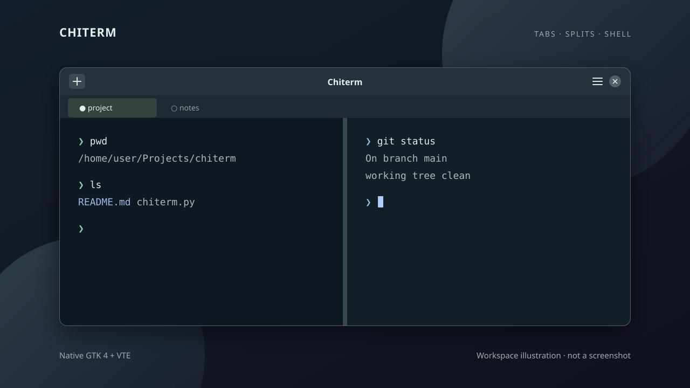

# Chiterm

[English](README.md) · [简体中文](README.zh-CN.md)

A native GTK 4 terminal for Omarchy and Linux desktops. Chiterm uses VTE to run real shells in tabs and split panes.



*Illustration, not a screenshot. The interface follows your GTK theme.*

## What it does

- Tabs and nested horizontal or vertical splits
- Scrollback search with smart case and regular expressions
- Four built-in terminal palettes, including dark and light options
- Keyboard pane navigation and temporary pane zoom
- Ctrl-click HTTP(S) links to open them in your browser
- New panes reuse the current directory when the shell reports it with OSC 7

## Quick start

On Omarchy or Arch Linux, install the system bindings:

```sh
sudo pacman -S python python-gobject gtk4 vte4
git clone https://github.com/chivopic/omarchy-terminal.git
cd omarchy-terminal
/usr/bin/python chiterm.py
```

Use system Python so it can load the GTK and VTE packages. Chiterm starts `$SHELL` when it is executable, otherwise `/bin/sh`.

## Core shortcuts

| Shortcut | Action |
| --- | --- |
| Ctrl+Shift+T | New tab |
| Ctrl+Shift+D / E | Split left/right / top/bottom |
| Ctrl+Shift+[ / ] | Previous / next pane |
| Ctrl+Shift+Enter | Zoom or restore focused pane |
| Ctrl+Shift+F | Search focused pane |
| Ctrl+Shift+W | Close pane or tab |
| Ctrl++ / Ctrl+- / Ctrl+0 | Zoom in / out / reset font |

See the [English user guide](docs/USER_GUIDE.md) for search controls and all shortcuts.

Themes change terminal colors only; the GTK title bar follows your desktop theme. The selected palette is saved in `$XDG_CONFIG_HOME/chiterm/config.json` (or `~/.config/chiterm/config.json`).

## Current limits

Chiterm is an early preview, not a drop-in iTerm2 replacement. Closing asks for confirmation and stops the affected shell and foreground process. Tabs and panes are not restored after exit. Profiles and automatic Omarchy color synchronization are not available.

## Project

[Roadmap](ROADMAP.md) · [Contributing](CONTRIBUTING.md) · [English manual](docs/USER_GUIDE.md) · [中文使用手册](docs/USER_GUIDE.zh-CN.md) · [MIT License](LICENSE)
