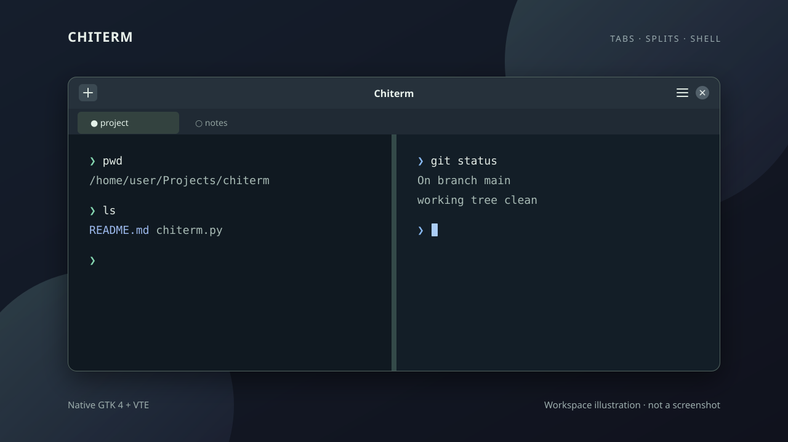

# Chiterm

[English](README.md) · [简体中文](README.zh-CN.md)

面向 Omarchy 和 Linux 桌面的原生 GTK 4 终端。Chiterm 使用 VTE，在标签页和分屏中运行真实 shell。



*这是界面示意图，不是应用截图。实际外观会跟随 GTK 主题。*

## 功能

- 标签页，以及可嵌套的左右或上下分屏
- 滚动回看搜索，支持智能大小写和正则表达式
- 内置四种终端配色，包含深色和浅色选项
- 键盘切换面板和临时最大化面板
- 按住 Ctrl 单击 HTTP(S) 链接，在浏览器中打开
- shell 通过 OSC 7 报告目录时，新面板会沿用当前目录

## 快速开始

在 Omarchy 或 Arch Linux 上安装系统绑定并启动：

```sh
sudo pacman -S python python-gobject gtk4 vte4
git clone https://github.com/chivopic/omarchy-terminal.git
cd omarchy-terminal
/usr/bin/python chiterm.py
```

请使用系统 Python 来加载 GTK 和 VTE 软件包。Chiterm 会启动可执行的 `$SHELL`，否则回退到 `/bin/sh`。

运行 `make install` 可在用户目录安装或更新，然后通过 `~/.local/bin/chiterm` 启动。`make uninstall` 只移除 Chiterm 安装文件，会保留用户设置。可用 `make install PREFIX="/custom/path"` 指定其他前缀。

## 常用快捷键

| 快捷键 | 操作 |
| --- | --- |
| Ctrl+Shift+T | 新建标签 |
| Ctrl+Shift+D / E | 左右 / 上下分屏 |
| Ctrl+Shift+[ / ] | 上一个 / 下一个面板 |
| Ctrl+Shift+Enter | 最大化 / 恢复当前面板 |
| Ctrl+Shift+F | 搜索当前面板 |
| Ctrl+Shift+W | 关闭面板或标签 |
| Ctrl++ / Ctrl+- / Ctrl+0 | 放大 / 缩小 / 重置字体 |

搜索选项和完整快捷键见[中文使用手册](docs/USER_GUIDE.zh-CN.md)。

配色只影响终端内容区；GTK 标题栏仍跟随桌面主题。当前配色保存在 `$XDG_CONFIG_HOME/chiterm/config.json`（未设置时为 `~/.config/chiterm/config.json`）。

运行 `chiterm --version` 可在不加载 GTK 的情况下查看版本；`chiterm --check` 会诊断 Python、GTK、VTE 和图形显示服务。

## 当前限制

Chiterm 仍处于早期预览阶段，不能替代完整的 iTerm2。关闭前会要求确认，并结束相关 shell 和前台进程。退出后不会恢复标签或面板。暂不支持配置档和 Omarchy 配色自动同步。

## 项目

[路线图](ROADMAP.md) · [参与贡献](CONTRIBUTING.md) · [English manual](docs/USER_GUIDE.md) · [中文使用手册](docs/USER_GUIDE.zh-CN.md) · [MIT 许可证](LICENSE)
