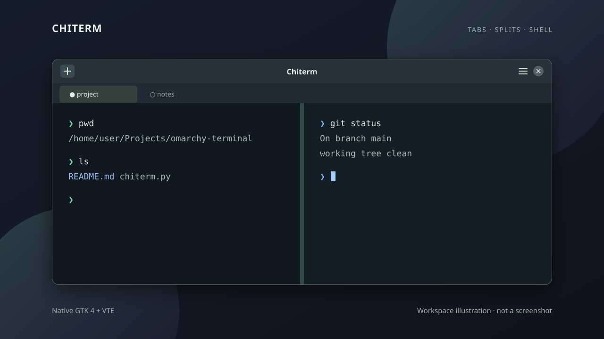

# Omarchy Terminal

[English](README.md) | 简体中文

一个受 iTerm2 日常工作流启发的原生终端，面向 Omarchy 和其他 Linux 桌面。应用基于 GTK 4 和 VTE，每个面板都运行真实 shell，支持终端程序、颜色和滚动回看。



*工作区示意图，实际外观取决于桌面主题。*

## MVP 功能

- 标签页：支持拖动排序和 shell 提供的标题
- 左右、上下分屏，支持嵌套
- 复制、粘贴、滚动回看和字体缩放
- 当 shell 通过 OSC 7 报告当前目录时，新标签和分屏会继承聚焦面板的目录；否则从主目录启动
- 原生 GTK 窗口，支持 Wayland 和 X11

这是早期 MVP，使用前请先了解[当前限制](#当前限制)。

## 运行

在 Omarchy / Arch Linux 上，如果缺少依赖，请先安装：

```sh
sudo pacman -S python python-gobject gtk4 vte4
```

克隆仓库并启动应用：

```sh
git clone https://github.com/chivopic/omarchy-terminal.git
cd omarchy-terminal
/usr/bin/python omarchy_terminal.py
```

请使用系统 Python：上面的软件包为它提供 GTK 和 VTE 绑定。应用优先使用 `$SHELL` 指向的可执行文件，不可用时回退到 `/bin/sh`。GTK 界面跟随桌面设置；终端颜色目前使用 VTE 默认值。

## 工作目录

新标签和分屏使用当前面板报告的本地目录。shell 需要发送 OSC 7 才能继承目录；如果没有有效的本地目录信息，新面板会从主目录启动。远程目录不会被当作本地路径使用。

## 使用面板和标签

使用标题栏的 **+** 按钮或菜单新建标签。点击面板使其获得焦点，再通过菜单或下方快捷键分屏。拖动分隔线可调整面板大小，拖动标签标题可调整顺序。关闭标签中的最后一个面板会关闭该标签。

## 当前限制

- 关闭面板或窗口前不会确认，即使其中有命令正在运行。
- 应用退出后不会恢复标签和面板。
- 尚未实现配置档、终端搜索和 Omarchy 终端配色自动同步。

## 常见问题

- **提示 `No module named gi`**：安装 `python-gobject`，并使用 `/usr/bin/python` 启动，避免使用没有系统绑定的虚拟环境。
- **找不到 GTK 或 VTE 命名空间**：检查是否安装了 `gtk4` 和 `vte4`。
- **窗口没有打开**：在正在运行的 Wayland 或 X11 桌面会话中启动，并查看启动终端里的错误信息。
- **新面板打开在主目录**：检查 shell 是否通过 OSC 7 报告当前目录。

## 路线图

接下来优先完善面板焦点和安全关闭，再考虑搜索、键盘导航和 Omarchy 主题集成。优先级和当前状态详见[路线图](ROADMAP.md#简体中文)。

## 参与贡献

欢迎提交 bug 报告和范围清晰的 PR，详见 [CONTRIBUTING.md](CONTRIBUTING.md)。

## 快捷键

| 快捷键 | 操作 |
| --- | --- |
| Ctrl+Shift+T | 新建标签 |
| Ctrl+Shift+D | 左右分屏 |
| Ctrl+Shift+E | 上下分屏 |
| Ctrl+Shift+W | 关闭当前面板（或标签） |
| Ctrl+Shift+C | 复制选中内容 |
| Ctrl+Shift+V | 粘贴 |
| Ctrl+Page Up | 上一个标签 |
| Ctrl+Page Down | 下一个标签 |
| Ctrl++ 或 Ctrl+= | 放大字体 |
| Ctrl+- | 缩小字体 |
| Ctrl+0 | 重置字体大小 |

关闭面板或窗口会结束其中的 shell 和前台进程，请先保存工作。点击面板可切换焦点，标题栏菜单也提供主要操作。

## 许可证

MIT
